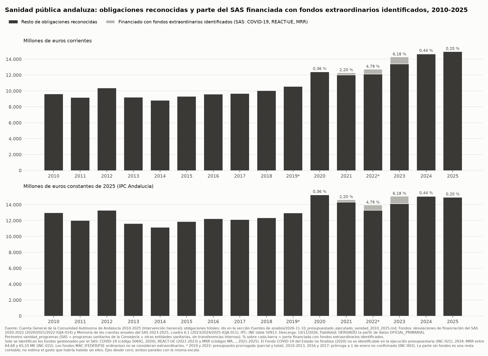

# Fondos extraordinarios en la sanidad pública andaluza, 2020-2025

> **Estado:** revisado. `validador-datos`: VALIDADO CON INCIDENCIAS. `auditor-neutralidad`: APROBADO CON CAMBIOS, cambios aplicados (ver el final).
>
> **Cómo leer la serie "sin fondos":** es una resta contable de las obligaciones financiadas con esos fondos. No estima cuál habría sido el gasto sin ellos ni les atribuye las variaciones interanuales.
> Complementa el informe de la serie larga (`analisis/2026-11-10_presupuestado_ejecutado_sanidad_2010_2025.md`), con el mismo perímetro (`sanidad_programas`).

## Pregunta

¿Qué parte del gasto ejecutado por la sanidad pública andaluza en 2020-2025 se financió con fondos extraordinarios (COVID-19, REACT-UE y Mecanismo de Recuperación y Resiliencia), y cómo queda la serie sin ellos?

## Respuesta resumida

- Las obligaciones reconocidas del SAS financiadas con fondos extraordinarios identificados son: 44,2 M€ en 2020, 270,0 M€ en 2021, 608,9 M€ en 2022, 881,2 M€ en 2023, 64,7 M€ en 2024 y 30,2 M€ en 2025. Sobre las obligaciones totales del perímetro sanitario suponen, respectivamente, el 0,36 %, 2,20 %, 4,79 %, 6,18 %, 0,44 % y 0,20 %.
- Por fondo: COVID-19 (código S0691): 2020; REACT-UE: 2021-2023; MRR: 2021-2025.
- Sin esos fondos, las obligaciones reconocidas son 12.392,7 M€ (2020), 12.010,5 M€ (2021), 12.109,3 M€ (2022), 13.385,1 M€ (2023), 14.648,7 M€ (2024) y 14.932,0 M€ (2025), en euros corrientes.
- **No se puede identificar** el Fondo COVID-19 del Estado de 2020. No figura con ese nombre ni en los ingresos ni en los gastos de la Cuenta General, y no tiene código de financiación en el gasto del SAS (INC-021). La serie "sin fondos" no lo descuenta.

## Tablas

Millones de euros. Perímetro `sanidad_programas`; fondos extraordinarios = obligaciones del SAS financiadas con ellos. \* 2019: presupuesto prorrogado hasta el 22 de julio; 2022: presupuesto prorrogado de 2021. La tabla empieza en 2019, último año sin estos fondos, para mostrar la primera variación. En 2010-2018 los valores con y sin fondos coinciden: están en el informe de la serie larga y en `data/processed/sanidad_sin_fondos_extraordinarios_2010_2025.csv`.

Lectura "% del total de la Junta" de la serie sin fondos: **no procede**. El denominador (total consolidado de la Junta) incluye fondos extraordinarios de otras secciones que no se han identificado, por lo que el cociente mezclaría criterios.

| Año | Obligaciones totales | COVID-19 | REACT-UE | MRR | Total fondos extraordinarios | % sobre el total | Sin fondos (M€ corrientes) | Sin fondos (M€ constantes 2025) | Sin fondos (€/habitante, corrientes) | Sin fondos (€/habitante, constantes 2025) |
|---|---|---|---|---|---|---|---|---|---|---|
| 2019* | 10.569,3 | 0,0 | 0,0 | 0,0 | 0,0 | 0,00 % | 10.569,3 | 12.959,0 | 1.256,1 | 1.540,1 |
| 2020 | 12.436,9 | 44,2 | 0,0 | 0,0 | 44,2 | 0,36 % | 12.392,7 | 15.226,1 | 1.464,1 | 1.798,8 |
| 2021 | 12.280,4 | 0,0 | 269,0 | 0,9 | 270,0 | 2,20 % | 12.010,5 | 14.307,3 | 1.417,6 | 1.688,7 |
| 2022* | 12.718,2 | 0,0 | 606,7 | 2,2 | 608,9 | 4,79 % | 12.109,3 | 13.273,5 | 1.424,6 | 1.561,6 |
| 2023 | 14.266,3 | 0,0 | 804,3 | 76,9 | 881,2 | 6,18 % | 13.385,1 | 14.118,9 | 1.562,1 | 1.647,8 |
| 2024 | 14.713,4 | 0,0 | 0,0 | 64,7† | 64,7 | 0,44 % | 14.648,7 | 15.044,3 | 1.699,5 | 1.745,4 |
| 2025 | 14.962,2 | 0,0 | 0,0 | 30,2 | 30,2 | 0,20 % | 14.932,0 | 14.932,0 | 1.723,0 | 1.723,0 |

† 2024: MRR entre 64,68 y 65,10 M€ (INC-022).

Variación interanual de las obligaciones reconocidas, con y sin fondos extraordinarios (todos los pares de años desde 2019):

| Periodo | Con fondos · € corrientes | Sin fondos · € corrientes | Con fondos · € constantes 2025 | Sin fondos · € constantes 2025 |
|---|---|---|---|---|
| 2019*→2020 | +17,7 % | +17,3 % | +17,9 % | +17,5 % |
| 2020→2021 | -1,3 % | -3,1 % | -4,3 % | -6,0 % |
| 2021→2022* | +3,6 % | +0,8 % | -4,7 % | -7,2 % |
| 2022*→2023 | +12,2 % | +10,5 % | +7,9 % | +6,4 % |
| 2023→2024 | +3,1 % | +9,4 % | +0,4 % | +6,6 % |
| 2024→2025 | +1,7 % | +1,9 % | -1,0 % | -0,7 % |

### Contexto: códigos MRR sanitarios de la Administración General de la Junta (no se restan)

Códigos del componente 18 del MRR (MR0618…) y MR04110302 ("Plan de atención digital personalizada de salud"), en la contabilidad de la Administración General (servicio 18). Millones de euros.

| Año | Derechos reconocidos (M€) | Obligaciones reconocidas (M€) |
|---|---|---|
| 2021 | NO_DISPONIBLE | NO_DISPONIBLE |
| 2022 | 143,21 | 76,64 |
| 2023 | 68,86 | 145,08 |
| 2024 | NO_DISPONIBLE | NO_DISPONIBLE |
| 2025 | 24,47 | 24,34 |

Estas obligaciones **no se restan** de la serie, por dos motivos:
1. Una parte son transferencias al SAS, cuyo gasto ya figura en las cifras del SAS.
2. El SAS las reconoce con desfase temporal. Ejemplo: la Administración General reconoce en 2022 obligaciones por 75,0 M€ del plan INVEAT, y el SAS registra 2,2 M€ de derechos por ese plan en 2022 y 76,3 M€ en 2023. Además, las obligaciones INVEAT de la Administración General en 2023 (140,51 M€) coinciden con sus derechos de 2022 (140,51 M€); queda pendiente comprobar si ese estado muestra cifras acumuladas (INC-023).

Sumar ambas contabilidades duplicaría importes (INC-023). En 2021 y 2024 el documento solo publica la desviación de financiación de estos códigos, no sus obligaciones.

## Gráfico

Fichero: `graficos/fondos_extraordinarios_2010_2025.{png,svg,csv}`.

## Metodología

- **Fuentes** (Cuenta General, `OFICIAL_PRIMARIA`):
  - SAS 2020-2022: "Desviación de financiación con gastos de financiación afectada".
  - SAS 2023-2025: Memoria de sus cuentas anuales, cuadro 6.1, en miles de euros.
  - Administración General 2020-2025: desviaciones de financiación del servicio 18 por código.
- **Clasificación,** solo con lo que dice el propio documento:
  - REACT-UE: fila "REACT-UE" del bloque de fondos europeos.
  - MRR: códigos de financiación que empiezan por "MR".
  - COVID-19: códigos cuya denominación contiene "COVID".
  - Los fondos europeos del marco ordinario (M.A.C. 2007-2013, 2014-2020 y 2021-2027) y el resto de transferencias finalistas del Estado (códigos S…) se tratan como **ordinarios**.
- **Serie sin fondos** = obligaciones reconocidas del perímetro `sanidad_programas` − obligaciones del SAS financiadas con COVID-19, REACT-UE y MRR. Solo para la fase de obligaciones: los estados utilizados no dan créditos por fondo. Es una resta contable, no un escenario.
- **Euros constantes de 2025:** IPC general de Andalucía, media anual (INE, tabla 50913). **Por habitante:** padrón a 1 de enero (INE).
- **Script:** `scripts/extraccion/fondos_extraordinarios.py` → `data/processed/fondos_extraordinarios_2020_2025.csv`; `scripts/analisis/sin_fondos.py` → `data/processed/sanidad_sin_fondos_extraordinarios_2010_2025.csv`; gráfico `graficos/fondos_extraordinarios_2010_2025.py`.

## Validación (`validador-datos`)

Cada año se comprueba (`data/interim/validacion_fondos.md`):

- **F1:** obligaciones de "Fondos Europeos" del SAS = obligaciones de los servicios 13, 16 y 17 del resumen por servicios del SAS (documento distinto).
- **F2:** obligaciones de "Gastos financiados con ingresos finalistas" = obligaciones del servicio 18.
- **F3:** suma de las filas de detalle = total de cada bloque.

**Resultado:** todo OK en 2020-2025, con diferencias de pocos euros en 2023-2025 por el redondeo a miles de la Memoria. Hay una excepción: en 2024 las filas de detalle de finalistas de la Memoria suman 422,39 miles de euros menos que su total. Es una incoherencia del documento oficial (INC-022), por la que el MRR del SAS en 2024 se sitúa entre 64,68 y 65,10 M€.

**Veredicto: VALIDADO CON INCIDENCIAS** (INC-021 a INC-023).

## Limitaciones

- Fondo COVID-19 del Estado (2020) no identificable (INC-021).
- Se descuentan los fondos extraordinarios ejecutados por el SAS. Los ejecutados directamente por la Consejería fuera del SAS no se pueden separar sin duplicar importes (INC-023). Su gasto directo con fondos europeos en programas sanitarios (capítulos I, II y VI de los servicios 13, 16 y 17) es de 2,1 M€ (2020), 2,0 M€ (2021) y 3,4 M€ (2022); las transferencias que realiza con esos fondos no se han desglosado por destinatario.
- En 2020 el SAS ejecutó 188,9 M€ con fondos europeos del M.A.C. 2014-2020. No se clasifican como extraordinarios porque el documento los identifica como fondos de ese marco.
- Gasto directo de la Consejería con fondos europeos en 2023-2025: `NO_DISPONIBLE`, porque la liquidación de esos años no desglosa servicios por programa.

## Revisión de neutralidad (`auditor-neutralidad`)

- **Fecha:** 2026-11-10.
- **Veredicto:** APROBADO CON CAMBIOS. Las cifras se contrastaron con los CSV; no se detectó lenguaje valorativo ni causalidad atribuida.
- **Cambios aplicados:**
  - "M.A.C. 2014-2020" en lugar de "FEDER".
  - Aclaración de que la serie sin fondos es una resta contable.
  - €/habitante en euros corrientes y constantes; "% del total" marcado como "no procede", con su motivo.
  - Fuentes de las obligaciones totales, del IPC y del padrón.
  - Título del gráfico limitado a la parte del SAS y a fondos identificados.
  - Prórrogas no confirmadas y fuentes en el pie del gráfico.
  - Redacción "COVID-19: 2020".
  - Base documental del Fondo COVID-19 limitada a INC-021.
  - Marcas en 2024 y en los periodos con años prorrogados.
  - Explicación de por qué la tabla empieza en 2019.
  - `NO_DISPONIBLE` para la Consejería en 2023-2025.
  - Nota pendiente sobre las cifras INVEAT de 2023.

## Fuentes

| id | Documento | Fecha de descarga | Fiabilidad |
|---|---|---|---|
| 2020-IGJA-014, 2021-IGJA-014, 2022-IGJA-014 | Cuenta General: desviación de financiación del SAS | 2026-11-10 | OFICIAL_PRIMARIA |
| 2023-IGJA-011, 2024-IGJA-011, 2025-IGJA-011 | Cuenta General: Memoria de las cuentas anuales del SAS (cuadro 6.1) | 2026-11-10 | OFICIAL_PRIMARIA |
| 2020-IGJA-015, 2021-IGJA-015, 2022-IGJA-015, 2023-IGJA-012, 2024-IGJA-012, 2025-IGJA-012 | Cuenta General: desviación de financiación de la Junta, servicio 18, por código | 2026-11-10 | OFICIAL_PRIMARIA |
| 2020-IGJA-008, 2021-IGJA-008, 2022-IGJA-008, 2023-IGJA-006, 2024-IGJA-006, 2025-IGJA-006 | Cuenta General: liquidación del SAS por servicios (validación) | 2026-11-10 | OFICIAL_PRIMARIA |
| 2020-IGJA-016 | Cuenta General 2020: liquidación de ingresos de la Junta por conceptos (INC-021) | 2026-11-10 | OFICIAL_PRIMARIA |
| Ver la sección Fuentes de `analisis/2026-11-10_presupuestado_ejecutado_sanidad_2010_2025.md` | Obligaciones totales del perímetro `sanidad_programas` (Cuenta General 2010-2025) | 2026-11-10 | OFICIAL_PRIMARIA (base) / DERIVADO (perímetro) |
| INE-IPC-001 | INE, IPC base 2021 por comunidades autónomas (tabla 50913) | 2026-11-10 | OFICIAL_SECUNDARIA |
| INE-POB-001, INE-POB-002 | INE, padrón (tabla 2853 y ficheros municipales) | 2026-11-10 | OFICIAL_SECUNDARIA |
| — | Cálculos de este documento | — | DERIVADO |
