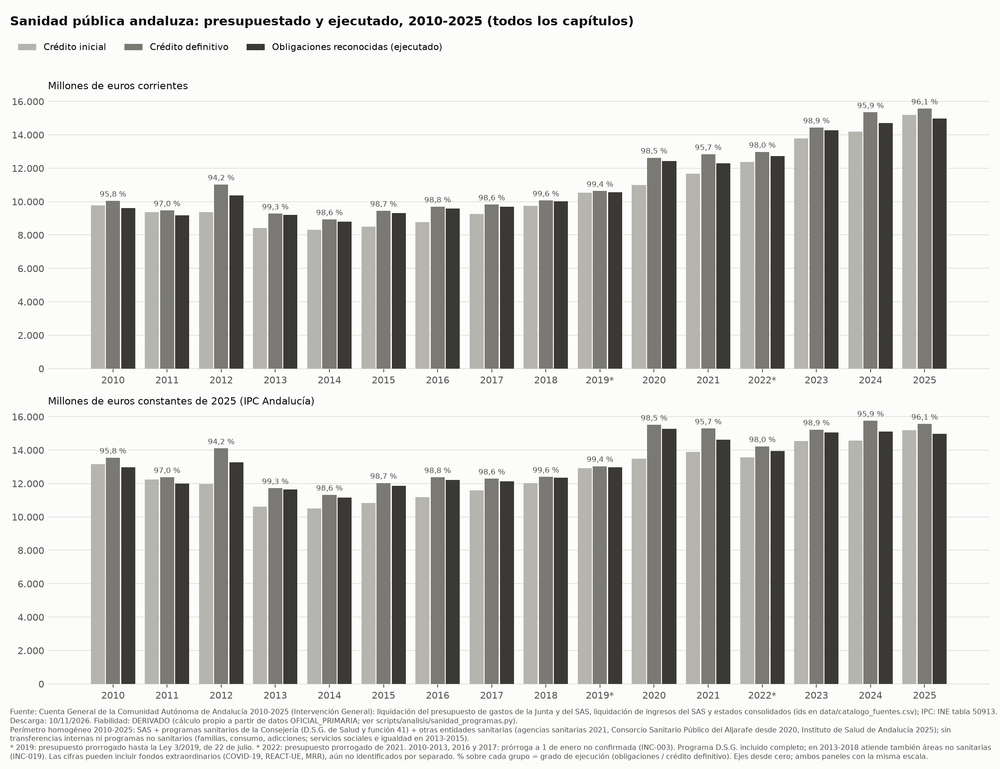
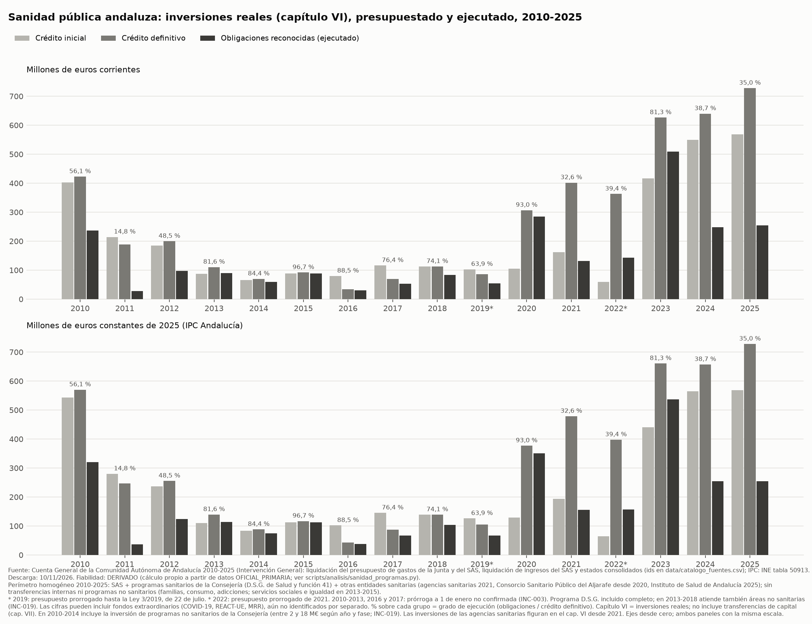

# Sanidad pública andaluza 2010-2025: presupuestado frente a ejecutado (serie larga)

> **Estado:** revisado. `validador-datos`: VALIDADO CON INCIDENCIAS. `auditor-neutralidad`: APROBADO CON CAMBIOS, cambios aplicados (ver el final).
> Este informe amplía a 2010-2025 el de 2020-2025 (`analisis/2026-11-10_presupuestado_ejecutado_sanidad_2020_2025.md`), con un perímetro homogéneo por programas sanitarios. Por eso sus cifras de 2020-2025 difieren ligeramente de aquel (ver "Diferencias con el informe 2020-2025").

## Pregunta

¿Cuánto se presupuestó y cuánto se ejecutó en la sanidad pública andaluza entre 2010 y 2025, en total y en inversiones reales (capítulo VI), con un perímetro homogéneo en todo el periodo?

## Respuesta resumida

- **Gasto total.** Las obligaciones reconocidas son 9.617,7 M€ en 2010 y 14.962,2 M€ en 2025, en euros corrientes. En euros constantes de 2025 son 12.973,0 M€ y 14.962,2 M€. La tasa media anual 2010→2025 es +3,0 % en euros corrientes y +1,0 % en euros constantes. Las variaciones de todos los años consecutivos están en la tabla correspondiente.
- **Grado de ejecución total** (obligaciones / crédito definitivo), año a año: 95,8 % (2010), 97,0 % (2011), 94,2 % (2012), 99,3 % (2013), 98,6 % (2014), 98,7 % (2015), 98,8 % (2016), 98,6 % (2017), 99,6 % (2018), 99,4 % (2019), 98,5 % (2020), 95,7 % (2021), 98,0 % (2022), 98,9 % (2023), 95,9 % (2024) y 96,1 % (2025).
- **Por habitante:** 1.148,9 € en 2010 y 1.726,5 € en 2025 (corrientes); 1.549,8 € y 1.726,5 € en euros constantes de 2025.
- **Peso en la Junta:** entre el 29,41 % (2020) y el 32,49 % (2012) del total de obligaciones del presupuesto consolidado de la Junta.
- **Inversiones reales (capítulo VI).** El grado de ejecución, año a año, es: 56,1 % (2010), 14,8 % (2011), 48,5 % (2012), 81,6 % (2013), 84,4 % (2014), 96,7 % (2015), 88,5 % (2016), 76,4 % (2017), 74,1 % (2018), 63,9 % (2019), 93,0 % (2020), 32,6 % (2021), 39,4 % (2022), 81,3 % (2023), 38,7 % (2024) y 35,0 % (2025). Las obligaciones reconocidas del capítulo VI van de 27,8 M€ (2011) a 509,3 M€ (2023).

## Tablas

Perímetro `sanidad_programas` (definición en "Metodología"). \* 2019: presupuesto prorrogado hasta el 22 de julio; 2022: presupuesto prorrogado de 2021.

#### Todos los capítulos — millones de euros corrientes

| Año | Crédito inicial | Crédito definitivo | Definitivo − inicial | Obligaciones reconocidas | Grado de ejecución |
|---|---|---|---|---|---|
| 2010 | 9.764,4 | 10.040,6 | 276,2 (+2,8 %) | 9.617,7 | 95,8 % |
| 2011 | 9.356,7 | 9.467,1 | 110,5 (+1,2 %) | 9.186,2 | 97,0 % |
| 2012 | 9.360,1 | 11.021,0 | 1.660,9 (+17,7 %) | 10.377,8 | 94,2 % |
| 2013 | 8.412,3 | 9.275,2 | 862,9 (+10,3 %) | 9.209,8 | 99,3 % |
| 2014 | 8.302,1 | 8.931,3 | 629,2 (+7,6 %) | 8.809,4 | 98,6 % |
| 2015 | 8.495,1 | 9.444,8 | 949,7 (+11,2 %) | 9.318,6 | 98,7 % |
| 2016 | 8.772,4 | 9.694,2 | 921,8 (+10,5 %) | 9.578,7 | 98,8 % |
| 2017 | 9.260,7 | 9.816,8 | 556,1 (+6,0 %) | 9.681,2 | 98,6 % |
| 2018 | 9.757,5 | 10.059,6 | 302,1 (+3,1 %) | 10.021,9 | 99,6 % |
| 2019* | 10.543,0 | 10.632,9 | 89,9 (+0,9 %) | 10.569,3 | 99,4 % |
| 2020 | 10.983,3 | 12.625,9 | 1.642,6 (+15,0 %) | 12.436,9 | 98,5 % |
| 2021 | 11.658,7 | 12.833,6 | 1.174,9 (+10,1 %) | 12.280,4 | 95,7 % |
| 2022* | 12.375,3 | 12.971,4 | 596,1 (+4,8 %) | 12.718,2 | 98,0 % |
| 2023 | 13.790,5 | 14.431,5 | 641,0 (+4,6 %) | 14.266,3 | 98,9 % |
| 2024 | 14.197,8 | 15.341,7 | 1.143,9 (+8,1 %) | 14.713,4 | 95,9 % |
| 2025 | 15.201,7 | 15.567,3 | 365,6 (+2,4 %) | 14.962,2 | 96,1 % |

#### Todos los capítulos — otras lecturas de las obligaciones reconocidas

| Año | M€ constantes 2025 | €/habitante (corrientes) | €/habitante (constantes 2025) | % del total consolidado de la Junta |
|---|---|---|---|---|
| 2010 | 12.973,0 | 1.148,9 | 1.549,8 | 30,64 % |
| 2011 | 12.004,3 | 1.090,5 | 1.425,0 | 30,84 % |
| 2012 | 13.274,6 | 1.228,1 | 1.571,0 | 32,49 % |
| 2013 | 11.632,5 | 1.091,2 | 1.378,2 | 30,12 % |
| 2014 | 11.157,6 | 1.048,4 | 1.327,9 | 30,06 % |
| 2015 | 11.867,6 | 1.109,5 | 1.413,0 | 32,32 % |
| 2016 | 12.221,3 | 1.141,9 | 1.457,0 | 31,22 % |
| 2017 | 12.116,2 | 1.155,3 | 1.445,9 | 29,54 % |
| 2018 | 12.348,2 | 1.195,3 | 1.472,8 | 29,72 % |
| 2019* | 12.959,0 | 1.256,1 | 1.540,1 | 29,80 % |
| 2020 | 15.280,4 | 1.469,3 | 1.805,3 | 29,41 % |
| 2021 | 14.628,9 | 1.449,5 | 1.726,6 | 30,57 % |
| 2022* | 13.940,9 | 1.496,2 | 1.640,1 | 30,75 % |
| 2023 | 15.048,4 | 1.665,0 | 1.756,2 | 31,82 % |
| 2024 | 15.110,8 | 1.707,0 | 1.753,1 | 31,96 % |
| 2025 | 14.962,2 | 1.726,5 | 1.726,5 | 31,35 % |

#### Capítulo VI · Inversiones reales — millones de euros corrientes

| Año | Crédito inicial | Crédito definitivo | Definitivo − inicial | Obligaciones reconocidas | Grado de ejecución |
|---|---|---|---|---|---|
| 2010 | 402,4 | 422,6 | 20,2 (+5,0 %) | 236,9 | 56,1 % |
| 2011 | 214,2 | 188,3 | -25,9 (-12,1 %) | 27,8 | 14,8 % |
| 2012 | 184,9 | 199,5 | 14,6 (+7,9 %) | 96,7 | 48,5 % |
| 2013 | 87,4 | 110,3 | 22,9 (+26,3 %) | 90,0 | 81,6 % |
| 2014 | 65,5 | 69,7 | 4,2 (+6,4 %) | 58,8 | 84,4 % |
| 2015 | 88,8 | 91,7 | 3,0 (+3,3 %) | 88,7 | 96,7 % |
| 2016 | 79,7 | 33,6 | -46,1 (-57,9 %) | 29,7 | 88,5 % |
| 2017 | 115,9 | 69,2 | -46,7 (-40,3 %) | 52,9 | 76,4 % |
| 2018 | 112,6 | 112,7 | 0,1 (+0,1 %) | 83,5 | 74,1 % |
| 2019* | 102,6 | 85,7 | -16,9 (-16,5 %) | 54,8 | 63,9 % |
| 2020 | 104,4 | 306,6 | 202,2 (+193,6 %) | 285,1 | 93,0 % |
| 2021 | 162,0 | 401,8 | 239,7 (+147,9 %) | 131,0 | 32,6 % |
| 2022* | 58,8 | 362,7 | 303,9 (+517,2 %) | 142,9 | 39,4 % |
| 2023 | 417,0 | 626,2 | 209,2 (+50,2 %) | 509,3 | 81,3 % |
| 2024 | 549,9 | 639,8 | 90,0 (+16,4 %) | 247,3 | 38,7 % |
| 2025 | 568,2 | 727,8 | 159,6 (+28,1 %) | 254,7 | 35,0 % |

#### Capítulo VI · Inversiones reales — otras lecturas de las obligaciones reconocidas

| Año | M€ constantes 2025 | €/habitante (corrientes) | €/habitante (constantes 2025) | % del total consolidado de la Junta |
|---|---|---|---|---|
| 2010 | 319,6 | 28,3 | 38,2 | 0,75 % |
| 2011 | 36,3 | 3,3 | 4,3 | 0,09 % |
| 2012 | 123,7 | 11,4 | 14,6 | 0,30 % |
| 2013 | 113,6 | 10,7 | 13,5 | 0,29 % |
| 2014 | 74,5 | 7,0 | 8,9 | 0,20 % |
| 2015 | 113,0 | 10,6 | 13,5 | 0,31 % |
| 2016 | 37,9 | 3,5 | 4,5 | 0,10 % |
| 2017 | 66,2 | 6,3 | 7,9 | 0,16 % |
| 2018 | 102,9 | 10,0 | 12,3 | 0,25 % |
| 2019* | 67,2 | 6,5 | 8,0 | 0,15 % |
| 2020 | 350,3 | 33,7 | 41,4 | 0,67 % |
| 2021 | 156,1 | 15,5 | 18,4 | 0,33 % |
| 2022* | 156,7 | 16,8 | 18,4 | 0,35 % |
| 2023 | 537,3 | 59,4 | 62,7 | 1,14 % |
| 2024 | 254,0 | 28,7 | 29,5 | 0,54 % |
| 2025 | 254,7 | 29,4 | 29,4 | 0,53 % |

#### Variación interanual de las obligaciones reconocidas (todos los pares de años consecutivos)

| Periodo | Total · € corrientes | Total · € constantes 2025 | Cap. VI · € corrientes | Cap. VI · € constantes 2025 |
|---|---|---|---|---|
| 2010→2011 | -4,5 % | -7,5 % | -88,3 % | -88,6 % |
| 2011→2012 | +13,0 % | +10,6 % | +247,8 % | +240,4 % |
| 2012→2013 | -11,3 % | -12,4 % | -7,0 % | -8,1 % |
| 2013→2014 | -4,3 % | -4,1 % | -34,6 % | -34,4 % |
| 2014→2015 | +5,8 % | +6,4 % | +50,8 % | +51,6 % |
| 2015→2016 | +2,8 % | +3,0 % | -66,5 % | -66,5 % |
| 2016→2017 | +1,1 % | -0,9 % | +78,1 % | +74,7 % |
| 2017→2018 | +3,5 % | +1,9 % | +57,9 % | +55,5 % |
| 2018→2019 | +5,5 % | +4,9 % | -34,4 % | -34,7 % |
| 2019→2020 | +17,7 % | +17,9 % | +420,3 % | +421,4 % |
| 2020→2021 | -1,3 % | -4,3 % | -54,1 % | -55,5 % |
| 2021→2022 | +3,6 % | -4,7 % | +9,1 % | +0,4 % |
| 2022→2023 | +12,2 % | +7,9 % | +256,4 % | +242,9 % |
| 2023→2024 | +3,1 % | +0,4 % | -51,4 % | -52,7 % |
| 2024→2025 | +1,7 % | -1,0 % | +3,0 % | +0,3 % |
| Tasa media anual 2010→2025 | +3,0 % | +1,0 % | +0,5 % | -1,5 % |

Notas a las tablas:
- El "% del total consolidado de la Junta" se calcula sobre el total de **todos los capítulos** de la Junta, en la misma fase.
- Capítulo VI en 2010-2014: incluye la inversión de los programas no sanitarios de la Consejería (entre 2 y 18 M€ según el año y la fase), que el documento disponible no permite separar (INC-019).
- Tasa media anual = (valor final / valor inicial)^(1/15) − 1, sobre la serie completa disponible. En el capítulo VI, con variaciones interanuales de entre −88,3 % y +420,3 %, la tasa media depende en gran medida de los valores del año inicial y del final.
- El capítulo VI no incluye transferencias de capital (capítulo VII). Hasta 2020 las agencias sanitarias se financian con transferencias de la Consejería, por lo que sus inversiones figuran en el capítulo VI a partir de 2021 (INC-016).
- "Definitivo − inicial" es el saldo neto de las modificaciones de crédito del ejercicio.

## Gráficos

Ficheros: `graficos/sanidad_total_fases_2010_2025.{png,svg,csv}` y `graficos/sanidad_cap6_fases_2010_2025.{png,svg,csv}`.

## Contexto necesario para leer las cifras

1. **Presupuestos prorrogados.** En 2019 rigió el presupuesto prorrogado de 2018 hasta la entrada en vigor de la Ley 3/2019, de 22 de julio (INC-002). 2022 se rigió por la prórroga del Presupuesto 2021, con el Decreto 286/2021 (INC-001). Para 2010-2013, 2016 y 2017 no se ha confirmado documentalmente si hubo prórroga a 1 de enero (INC-003).
2. **Cambios de competencias de la Consejería.** Bienestar social en 2013; igualdad y políticas sociales en 2014-2015; familias y consumo en 2016-2019 y siguientes. El perímetro por programas excluye esas competencias. En 2010-2012 quedan fuera entre 30,6 y 31,9 M€ anuales de programas no sanitarios no identificados individualmente (INC-019). El programa de Dirección y Servicios Generales (incluido) atiende en 2013-2018 también a las áreas no sanitarias de la Consejería (INC-019).
3. **Agencias públicas empresariales sanitarias.** Hasta 2020 se financian con transferencias de la Consejería, incluidas en el perímetro. En 2021 tienen sección propia en el consolidado, y desde 2022 su actividad está integrada en el SAS (INC-016).
4. **Modificaciones de crédito.** La diferencia entre crédito definitivo e inicial varía entre +0,9 % (2019) y +17,7 % (2012); figura para todos los años en la tabla. Las modificaciones de crédito de cada ejercicio no se han analizado todavía; la de 2012, que es la mayor de la serie, está registrada como INC-020.
5. **Fondos extraordinarios.** Las cifras pueden incluir fondos extraordinarios (COVID-19, REACT-UE, MRR), aún no identificados por separado (INC-017).

## Metodología

- **Perímetro `sanidad_programas`** (decisión del usuario: serie larga por programas sanitarios equivalentes), igual para todos los años:
  - el SAS completo;
  - más los programas sanitarios de la Consejería: Dirección y Servicios Generales (41A hasta 2018, 12O en 2019-2022, 12S desde 2023) y los de la función 41 "Sanidad" (41C, 41D, 41H, 41J, 41K…), según `data/equivalencias/programas.csv`;
  - más otras entidades sanitarias con sección propia en el consolidado (agencias sanitarias en 2021, Consorcio Sanitario Público del Aljarafe desde 2020, Instituto de Salud de Andalucía en 2025);
  - menos las transferencias internas entre todas ellas.

  Quedan fuera los programas no sanitarios de la Consejería: Apoyo a Familias (31P), Consumo (44H), Plan sobre Adicciones (31B) y, en 2013-2015, los de servicios sociales, dependencia e igualdad.
- **Cálculo** (`scripts/analisis/sanidad_programas.py`):
  - **2010-2019.** SAS (liquidación propia) + programas sanitarios (resumen por programas de la Cuenta General) − transferencias de la Junta al SAS.
    - Las transferencias se toman de los ingresos del SAS: conceptos 450 (corrientes) y 750 (capital).
    - Para el crédito inicial y el definitivo, la previsión inicial y la definitiva.
    - Para las obligaciones, la misma medida que elimina la consolidación oficial: derechos reconocidos netos en 2010-2016 y previsión definitiva en 2017-2019 (INC-018).
  - **2020-2022.** Consolidado oficial de las secciones sanitarias − programas no sanitarios de la Consejería.
  - **2023-2025.** Consolidado oficial por programa, sin los programas no sanitarios de la Consejería.
- **Euros constantes de 2025:** IPC general de Andalucía, media anual (INE, tabla 50913). **Por habitante:** padrón a 1 de enero (INE). **% del total:** total consolidado de la Junta en la misma fase.

## Validación (`validador-datos`)

- Estados consolidados 2010-2025: 3.024 comprobaciones de cuadre (capítulos = total de sección; suma de secciones = total general impreso), 0 descuadres.
- En los años siguientes, las transferencias medidas con los ingresos del SAS coinciden al céntimo con lo que elimina la consolidación oficial:
  - crédito inicial y definitivo: 2010-2013 y 2016-2019;
  - obligaciones: 2010-2013, 2016-2017 y 2019 (`data/interim/transferencias_junta_sas_2010_2022.csv`).
- 2016-2019: la diferencia entre el consolidado oficial (Consejería + SAS) y la serie por programas es exactamente el gasto de los programas no sanitarios de la sección (34,1; 39,7; 45,7 y 56,4 M€; `data/interim/validacion_sanidad_programas.md`).
- 2020-2022: el método de 2010-2019 y el de 2020-2022 dan el mismo resultado al céntimo en 2020 y 2022. En 2021 difieren 1,06 M€, que son transferencias del SAS a las agencias sanitarias; se usa el consolidado oficial, que las elimina.
- Consolidación oficial verificada partida a partida en 2020-2022 (`data/interim/validacion_consolidacion.md`).
- **Veredicto: VALIDADO CON INCIDENCIAS** (INC-003, INC-016 a INC-020).

## Diferencias con el informe 2020-2025

El informe 2020-2025 usa el perímetro por secciones (`sanidad_consolidado`), que incluye los programas 31B, 31P y 44H de la Consejería. Este informe los excluye para que la serie sea homogénea desde 2010. Diferencia en obligaciones reconocidas (M€): 83,7 (2020), 90,1 (2021), 97,4 (2022), 45,1 (2023), 46,5 (2024) y 46,6 (2025). Las dos series están en `data/processed/metricas_sanidad_2010_2025.csv`.

## Limitaciones

- Capítulos distintos del VI no se publican para 2010-2014: el resumen por programas de esos años no desglosa capítulos.
- Fondos extraordinarios no separados (INC-017).
- Las transferencias al SAS de 2010-2019 se miden con los ingresos del SAS, validados contra la consolidación oficial en los años en que es posible (ver "Validación").

## Revisión de neutralidad (`auditor-neutralidad`)

- **Fecha:** 2026-11-10.
- **Veredicto:** APROBADO CON CAMBIOS. Todas las cifras se contrastaron con `data/processed/metricas_sanidad_2010_2025.csv`; no se detectó lenguaje valorativo; se mantienen los criterios de la revisión del informe 2020-2025.
- **Cambios aplicados:**
  - Redacción exacta de la validación (sin afirmar que la sección fuera solo sanitaria).
  - Notas sobre el capítulo VII y las agencias sanitarias.
  - Corrección de identificadores en el script de gráficos.
  - Grado de ejecución total de todos los años, simétrico con el del capítulo VI.
  - Columna "Definitivo − inicial" para todos los años, para no destacar un único ejercicio.
  - Nota sobre la tasa media del capítulo VI.
  - Prórrogas no confirmadas y alcance del programa D.S.G. en el pie de los gráficos.
  - Identificadores de fuente completos.

## Fuentes

| id | Documento | Fecha de descarga | Fiabilidad |
|---|---|---|---|
| 2010-IGJA-001 … 2010-IGJA-008, …, 2019-IGJA-001 … 2019-IGJA-008 | Cuenta General 2010-2019: liquidación de gastos de la Junta y del SAS (resúmenes por secciones, capítulos, servicios y programas) | 2026-11-10 | OFICIAL_PRIMARIA |
| 2010-IGJA-009 … 2019-IGJA-009; 2020-IGJA-013, 2021-IGJA-013, 2022-IGJA-013; 2023-IGJA-009/010, 2024-IGJA-009/010, 2025-IGJA-009/010 | Cuenta General: estados consolidados de gastos | 2026-11-10 | OFICIAL_PRIMARIA |
| 2010-IGJA-010/011 … 2019-IGJA-010/011; 2020-IGJA-011/012, 2021-IGJA-011/012, 2022-IGJA-011/012 | Cuenta General: liquidación de ingresos del SAS | 2026-11-10 | OFICIAL_PRIMARIA |
| 2020-IGJA-005, 2021-IGJA-005, 2022-IGJA-005; 2023-IGJA-002, 2024-IGJA-002, 2025-IGJA-002 | Cuenta General: liquidación por programas y partidas de la Junta | 2026-11-10 | OFICIAL_PRIMARIA |
| INE-IPC-001, INE-POB-001, INE-POB-002 | INE: IPC (tabla 50913) y padrón (tabla 2853 y ficheros municipales) | 2026-11-10 | OFICIAL_SECUNDARIA |
| 2021-BOJA-N01, 2021-BOJA-N02, 2021-BOJA-N03, 2022-BOJA-001, 2019-HAC-L01 | Normativa citada en el contexto | 2026-11-10 | OFICIAL_PRIMARIA |
| — | Cálculos de este documento | — | DERIVADO |
