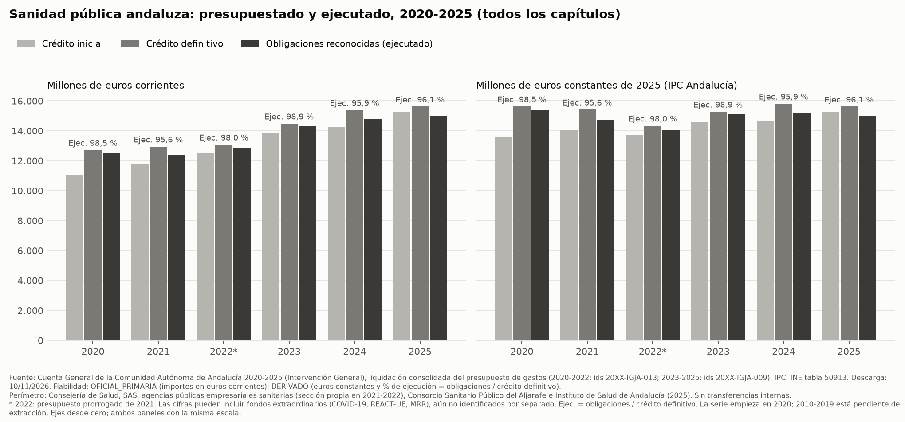
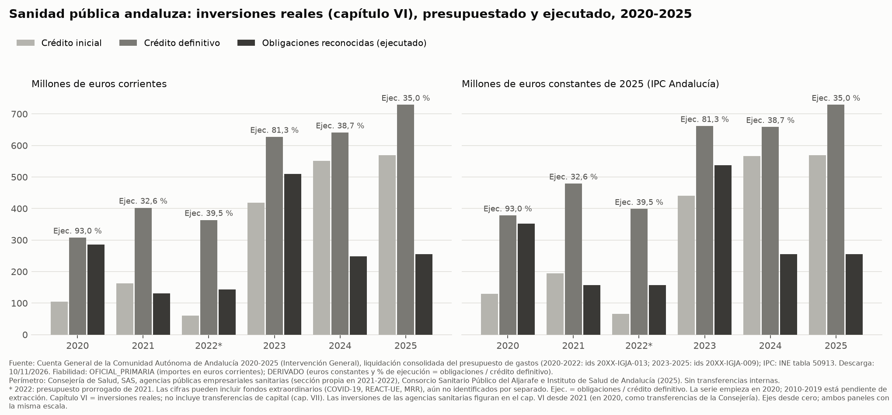

# Sanidad pública andaluza 2020-2025: presupuestado frente a ejecutado

> **Estado:** revisado. `validador-datos`: VALIDADO CON INCIDENCIAS. `auditor-neutralidad`: APROBADO CON CAMBIOS, cambios aplicados (ver el final del documento).
> La serie empieza en 2020; la extracción de 2010-2019 está pendiente.

## Pregunta

¿Cuánto se presupuestó y cuánto se ejecutó en la sanidad pública andaluza entre 2020 y 2025, en total y en inversiones reales (capítulo VI)?

## Respuesta resumida

- **Gasto total.** Las obligaciones reconocidas (gasto ejecutado) del perímetro sanitario consolidado son 12.520,6 M€ en 2020 y 15.008,9 M€ en 2025, en euros corrientes. En euros constantes de 2025 son 15.383,3 M€ y 15.008,9 M€. La tasa media anual 2020→2025 es +3,7 % en euros corrientes y −0,5 % en euros constantes. El grado de ejecución (obligaciones / crédito definitivo) se sitúa entre el 95,6 % (2021) y el 98,9 % (2023).
- **Por habitante.** Las obligaciones reconocidas por habitante son 1.479,2 € en 2020 y 1.731,8 € en 2025 (corrientes); 1.817,4 € y 1.731,8 € en euros constantes de 2025.
- **Peso en la Junta.** Sobre el total de obligaciones del presupuesto consolidado de la Junta, el perímetro sanitario representa entre el 29,60 % (2020) y el 32,06 % (2024).
- **Inversiones reales (capítulo VI).** El grado de ejecución es del 93,0 % (2020), 32,6 % (2021), 39,5 % (2022), 81,3 % (2023), 38,7 % (2024) y 35,0 % (2025). Los importes de cada fase y año están en la tabla del capítulo VI. Las obligaciones reconocidas del capítulo VI representan entre el 0,33 % (2021) y el 1,14 % (2023) del total de obligaciones del presupuesto consolidado de la Junta.

Las variaciones de todos los años consecutivos están en la tabla correspondiente. Ningún año se ha seleccionado como referencia.

## Tablas

Perímetro `sanidad_consolidado` (definición más abajo). \* 2022: presupuesto prorrogado de 2021.

#### Todos los capítulos — millones de euros corrientes

| Año | Crédito inicial | Crédito definitivo | Obligaciones reconocidas | Grado de ejecución |
|---|---|---|---|---|
| 2020 | 11.056,2 | 12.717,2 | 12.520,6 | 98,5 % |
| 2021 | 11.772,5 | 12.939,6 | 12.370,6 | 95,6 % |
| 2022* | 12.487,9 | 13.074,0 | 12.815,6 | 98,0 % |
| 2023 | 13.837,5 | 14.477,8 | 14.311,4 | 98,9 % |
| 2024 | 14.246,1 | 15.389,6 | 14.759,9 | 95,9 % |
| 2025 | 15.249,6 | 15.615,6 | 15.008,9 | 96,1 % |

#### Todos los capítulos — otras lecturas de las obligaciones reconocidas

| Año | M€ constantes 2025 | €/habitante (corrientes) | €/habitante (constantes 2025) | % del total consolidado de la Junta |
|---|---|---|---|---|
| 2020 | 15.383,3 | 1.479,2 | 1.817,4 | 29,60 % |
| 2021 | 14.736,3 | 1.460,1 | 1.739,3 | 30,79 % |
| 2022* | 14.047,8 | 1.507,7 | 1.652,6 | 30,98 % |
| 2023 | 15.096,0 | 1.670,2 | 1.761,8 | 31,92 % |
| 2024 | 15.158,5 | 1.712,4 | 1.758,6 | 32,06 % |
| 2025 | 15.008,9 | 1.731,8 | 1.731,8 | 31,45 % |

#### Capítulo VI · Inversiones reales — millones de euros corrientes

| Año | Crédito inicial | Crédito definitivo | Obligaciones reconocidas | Grado de ejecución |
|---|---|---|---|---|
| 2020 | 104,8 | 307,5 | 285,8 | 93,0 % |
| 2021 | 163,1 | 402,1 | 131,2 | 32,6 % |
| 2022* | 59,6 | 363,4 | 143,6 | 39,5 % |
| 2023 | 417,7 | 627,0 | 509,8 | 81,3 % |
| 2024 | 550,9 | 641,0 | 248,0 | 38,7 % |
| 2025 | 569,1 | 728,7 | 254,8 | 35,0 % |

#### Capítulo VI · Inversiones reales — otras lecturas de las obligaciones reconocidas

| Año | M€ constantes 2025 | €/habitante (corrientes) | €/habitante (constantes 2025) | % del total consolidado de la Junta |
|---|---|---|---|---|
| 2020 | 351,2 | 33,8 | 41,5 | 0,68 % |
| 2021 | 156,3 | 15,5 | 18,4 | 0,33 % |
| 2022* | 157,4 | 16,9 | 18,5 | 0,35 % |
| 2023 | 537,7 | 59,5 | 62,8 | 1,14 % |
| 2024 | 254,7 | 28,8 | 29,5 | 0,54 % |
| 2025 | 254,8 | 29,4 | 29,4 | 0,53 % |

#### Desglose por entidad — obligaciones reconocidas, millones de euros corrientes

| Año | Consejería | SAS | Agencias sanitarias | Consorcio Aljarafe | Instituto de Salud de Andalucía | **Total** |
|---|---|---|---|---|---|---|
| 2020 | 967,1 | 11.488,9 | — | 64,6 | — | 12.520,6 |
| 2021 | 231,6 | 11.333,5 | 740,9 | 64,6 | — | 12.370,6 |
| 2022* | 248,6 | 12.499,5 | 0,0 | 67,6 | — | 12.815,6 |
| 2023 | 249,6 | 13.994,3 | — | 67,6 | — | 14.311,4 |
| 2024 | 252,6 | 14.427,3 | — | 80,0 | — | 14.759,9 |
| 2025 | 267,5 | 14.657,5 | — | 83,8 | 0,0 | 15.008,9 |

#### Variación interanual de las obligaciones reconocidas (todos los pares de años consecutivos)

| Periodo | Total · € corrientes | Total · € constantes 2025 | Cap. VI · € corrientes | Cap. VI · € constantes 2025 |
|---|---|---|---|---|
| 2020→2021 | -1,2 % | -4,2 % | -54,1 % | -55,5 % |
| 2021→2022 | +3,6 % | -4,7 % | +9,4 % | +0,7 % |
| 2022→2023 | +11,7 % | +7,5 % | +255,1 % | +241,7 % |
| 2023→2024 | +3,1 % | +0,4 % | -51,4 % | -52,6 % |
| 2024→2025 | +1,7 % | -1,0 % | +2,8 % | +0,1 % |
| Tasa media anual 2020→2025 | +3,7 % | -0,5 % | -2,3 % | -6,2 % |

Notas a las tablas:
- El "% del total consolidado de la Junta" se calcula siempre sobre el total de **todos los capítulos** de la Junta, en la misma fase (obligaciones sobre obligaciones).
- En el desglose por entidad, "—" significa que la entidad no tiene sección propia ese año. En 2021 las agencias sanitarias tienen sección propia en el consolidado; en 2022 su sección figura con 0,0 porque la actividad pasó al SAS (ver Contexto).

## Gráficos

- `graficos/sanidad_total_fases_2020_2025.png` (y `.svg`, datos en `.csv`)
- `graficos/sanidad_cap6_fases_2020_2025.png` (y `.svg`, datos en `.csv`)

## Contexto necesario para leer las cifras

1. **2022 es un ejercicio con presupuesto prorrogado.** Rigió la prórroga del Presupuesto 2021 (Decreto 286/2021, de 28 de diciembre). El crédito inicial de 2022 es el de la documentación oficial de la prórroga (INC-001).
2. **Agencias públicas empresariales sanitarias.** Hasta 2020, la Consejería financiaba mediante transferencias a la A.P.E. Sanitaria Costa del Sol, la Empresa Pública de Emergencias Sanitarias, y las A.P.E. Sanitarias Hospital de Poniente, Hospital Alto Guadalquivir y Bajo Guadalquivir (658,6 M€ de crédito inicial en 2020). El Decreto 193/2021, de 6 de julio, dispone que el SAS asuma sus fines, y los Decretos 290/2021 a 294/2021, de 28 de diciembre, las disuelven. En 2021 estas agencias figuran como secciones propias en el consolidado (740,9 M€ de obligaciones); desde 2022 su actividad está dentro del SAS. En 2020 la actividad de las agencias figura en el total como transferencias de la Consejería (capítulo IV). En 2021 figura como gasto directo de las agencias, y desde 2022 como gasto del SAS. Ambos importes están dentro del perímetro elegido, pero no son necesariamente equivalentes; la diferencia no se ha cuantificado (INC-016). El reparto por entidad y por capítulo cambia entre 2020 y 2022.
3. **Fondos extraordinarios.** Las cifras pueden incluir fondos extraordinarios (COVID-19, REACT-UE, Mecanismo de Recuperación y Resiliencia). Todavía no se han identificado por separado, así que la serie sin ellos está pendiente (INC-017).
4. **Crédito definitivo y modificaciones.** El crédito definitivo incluye las modificaciones aprobadas durante el ejercicio (generaciones, incorporaciones, transferencias de crédito…). Parte del crédito no ejecutado de un año puede incorporarse al siguiente (incorporaciones de crédito); no se ha cuantificado.
5. **Capítulo VI.** Recoge las inversiones reales que ejecutan directamente las entidades del perímetro. No incluye las transferencias de capital a terceros (capítulo VII) ni las inversiones que realicen otras entidades no incluidas en el perímetro. Las inversiones de las agencias sanitarias figuran en el capítulo VI desde 2021 (en 2021 en sus propias secciones, desde 2022 dentro del SAS). En 2020 se financiaban mediante transferencias de la Consejería (capítulos IV y VII), fuera del capítulo VI del perímetro (INC-016).

## Metodología

- **Fuente principal:** Cuenta General de la Comunidad Autónoma de Andalucía (Intervención General), liquidación **consolidada** del presupuesto de gastos. La consolidación oficial elimina las transferencias entre la Junta y sus entidades, de modo que el gasto no se cuenta dos veces.
- **Perímetro `sanidad_consolidado`** (decisión del usuario, 2026-11-10): todas las entidades sanitarias con sección propia en el consolidado. Son la Consejería competente en Salud y el SAS (todos los años), las agencias públicas empresariales sanitarias (2021-2022), el Consorcio Sanitario Público del Aljarafe (todos los años) y el Instituto de Salud de Andalucía (2025). Las secciones de cada año se identifican por su nombre en el documento (`data/equivalencias/perimetro_sanidad.csv`).
- **Fases:** crédito inicial, crédito definitivo y obligaciones reconocidas netas. Grado de ejecución = obligaciones / crédito definitivo × 100.
- **Euros constantes de 2025:** importe × IPC(2025) / IPC(año), con el IPC general de Andalucía en media anual (INE, tabla 50913, media de los 12 índices mensuales).
- **Por habitante:** población a 1 de enero de cada año según el padrón municipal (INE).
- **% del total:** sobre el total de obligaciones (o créditos, en su fase) del presupuesto consolidado de la Junta.
- **Reproducción:** `scripts/extraccion/consolidado.py`, `scripts/analisis/series_base.py`, `scripts/analisis/perimetro_sanidad.py`, `scripts/analisis/metricas_sanidad.py`, `scripts/analisis/tablas_informe_2020_2025.py` y `graficos/fases_sanidad_2020_2025.py`.

## Validación (`validador-datos`)

- Extracción del consolidado: 2.085 comprobaciones de cuadre (capítulos = total de sección o programa; suma de secciones = total consolidado de la Junta impreso), 0 descuadres.
- Consolidación verificada de forma independiente en 2020-2022. Consejería sin consolidar − transferencias a entidades del consolidado (artículos 41 y 71 de la clasificación económica, leídos partida a partida) = Consejería en el consolidado oficial, al céntimo en los tres años (`data/interim/validacion_consolidacion.md`).
- Liquidación sin consolidar de la Consejería y el SAS: 8 de 9 comprobaciones OK (`data/interim/validacion_liquidacion.md`). Queda un aviso: las discrepancias con la web del SAS (INC-006).
- Población: la suma municipal del padrón reproduce la tabla oficial del INE en los 12 años en que existen ambas (2010-2021). IPC: la media de 2021 da 100,000 (año base del índice).
- **Veredicto: VALIDADO CON INCIDENCIAS** (INC-006, INC-016, INC-017).

## Limitaciones

- La serie empieza en 2020; la extracción de 2010-2019 está pendiente.
- Fondos extraordinarios no separados (INC-017).
- En 2020-2022 el consolidado oficial desglosa por sección y capítulo; no incluye desglose por programa.

## Revisión de neutralidad (`auditor-neutralidad`)

- **Fecha:** 2026-11-10.
- **Veredicto:** APROBADO CON CAMBIOS. Todas las cifras se contrastaron con `data/processed/metricas_sanidad_2010_2025.csv`; no se detectó lenguaje valorativo.
- **Cambios aplicados:**
  1. Registro de INC-016 e INC-017.
  2. Redacción descriptiva del efecto de las agencias sanitarias sobre el total, sin afirmar que sea neutro.
  3. Grado de ejecución del capítulo VI para todos los años, no para una selección.
  4. Porcentaje del capítulo VI expresado sobre el total de la Junta, que figura en las tablas.
  5. Nota sobre las inversiones de las agencias en el contexto y en el pie del gráfico.
  6. Paleta de grises en lugar de azules en los gráficos.
  7. Identificadores de fuente por periodo en el pie.
  8. Aviso de que la serie empieza en 2020 por disponibilidad de extracción.
  9. Eliminación de «solo».
  10. Asterisco de 2022 en el desglose por entidad.

## Fuentes

| id | Documento | Fecha de descarga | Fiabilidad |
|---|---|---|---|
| 2020-IGJA-013, 2021-IGJA-013, 2022-IGJA-013 | Cuenta General 2020-2022. Estados consolidados 10.5: liquidación del presupuesto de gastos por sección y capítulo | 2026-11-10 | OFICIAL_PRIMARIA |
| 2023-IGJA-009, 2024-IGJA-009, 2025-IGJA-009 | Cuenta General 2023-2025. Liquidación del presupuesto de gastos consolidado por secciones/programas/capítulos (7.1.2) | 2026-11-10 | OFICIAL_PRIMARIA |
| 2023-IGJA-010, 2024-IGJA-010, 2025-IGJA-010 | Cuenta General 2023-2025. Liquidación consolidada por capítulo (7.1.1), total de control | 2026-11-10 | OFICIAL_PRIMARIA |
| 2020-IGJA-005, 2021-IGJA-005, 2022-IGJA-005 | Cuenta General 2020-2022. Detalle por partida de la Junta (verificación de la consolidación) | 2026-11-10 | OFICIAL_PRIMARIA |
| 2020-HAC-003, 2021-HAC-003 | Estado de gastos de la Consejería 2020 y 2021 (transferencias a las agencias sanitarias) | 2026-11-10 | OFICIAL_PRIMARIA |
| INE-IPC-001 | INE, IPC base 2021 por comunidades autónomas (tabla 50913) | 2026-11-10 | OFICIAL_SECUNDARIA |
| INE-POB-001, INE-POB-002 | INE, cifras oficiales de población (padrón): tabla 2853 y ficheros municipales | 2026-11-10 | OFICIAL_SECUNDARIA |
| 2021-BOJA-N01, N02, N03 | Decreto 193/2021; Decretos 290/2021 y 294/2021 (BOJA) | 2026-11-10 | OFICIAL_PRIMARIA |
| — | Cálculos de este documento (euros constantes, por habitante, %, variaciones) | — | DERIVADO |
